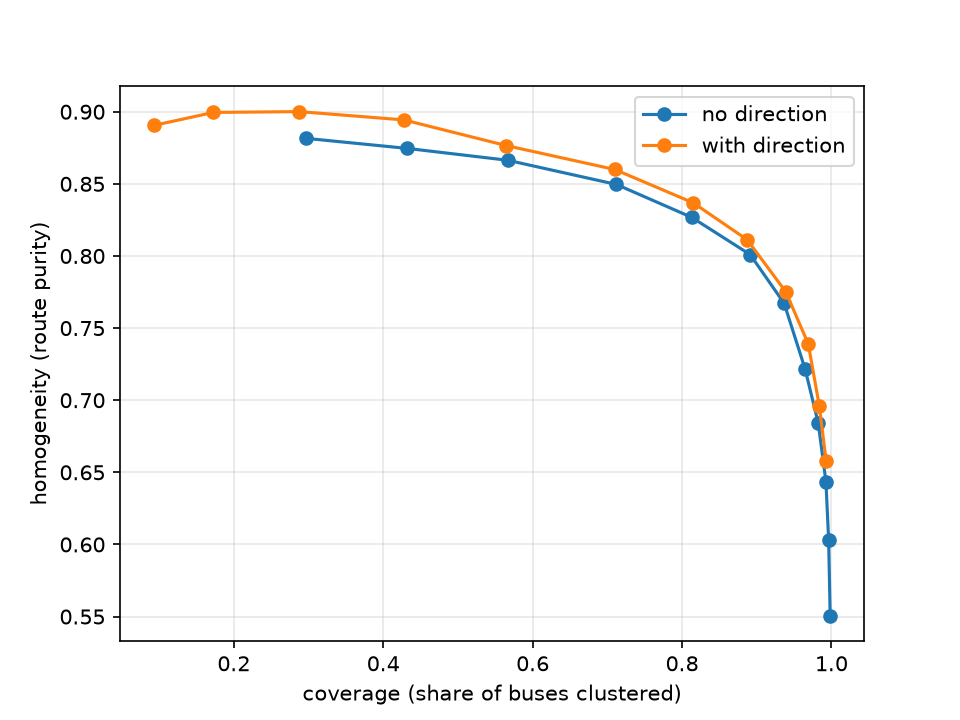
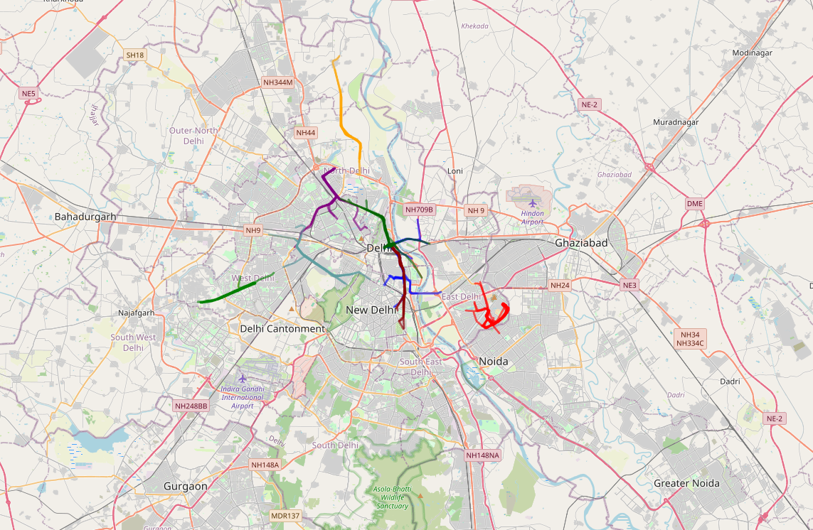

<h1 align="center">Saajha</h1>

<b>Mapping Delhi's shared e-rickshaw network with GPS traces and machine learning</b>

  
  
  

---

## Why

Shared e-rickshaws carry a huge share of Delhi's last-mile trips, running fixed informal routes between metro stations and neighborhoods. None of these routes appear on any map. **Saajha** builds that map: it turns raw GPS traces into routes, stops, fares and frequencies, published as a standard transit feed (GTFS).

## Approach

Before collecting e-rickshaw data, the pipeline is built and validated on Delhi's **live bus GPS feed**, where the true routes and stops are known.

| Step | Method |
|---|---|
| Clean | Remove GPS jumps using a rolling-median distance filter |
| Detect stops | Find stationary points, cluster with DBSCAN (haversine), require multiple vehicles |
| Extract routes | Represent each trace as direction-aware map cells, cluster with average-linkage agglomerative clustering |
| Evaluate | Compare against official GTFS stops and route labels |

## Key results (live bus GPS: 1 hour, 6,122 vehicles, 471k points)

| Task | Result |
|---|---|
| Stop detection | **54%** of detected stops within 50 m of a real stop, **73%** within 100 m (1,149 stops) |
| Route extraction | **~89%** of vehicles clustered at **0.81** route purity (homogeneity) |

### Stop detection

| Min. vehicles pausing | Detected stops | Within 50 m | Within 100 m |
|---|---|---|---|
| 2 | 1,587 | 47% | 69% |
| 3 | 1,318 | 51% | 72% |
| 5 | 832 | 50% | 72% |

Removing detections within 40 m of an OpenStreetMap traffic signal raised precision to **54% / 73%**, at the cost of 169 stops. Gains are limited because OSM maps only ~1,500 signals in Delhi. With 4× more data, detected stops more than doubled while precision held steady.

### Route extraction

| Method | Clusters | Coverage | Homogeneity | Completeness |
|---|---|---|---|---|
| DBSCAN | 259 | 42% | 0.54 | 0.89 |
| Average linkage (t = 0.5) | 1,062 | 81% | 0.83 | 0.85 |
| + Direction-aware tokens (t = 0.7) | 815 | 94% | 0.78 | 0.84 |

DBSCAN suffers from *chaining*: shared corridors link unrelated routes, and it got **worse** with more data (homogeneity 0.72 → 0.54). Average linkage avoids this and turned the extra data into higher coverage (69% → 81% at the same purity). Adding travel direction gives purer routes at every coverage level:

<i>Route purity vs. coverage across clustering thresholds</i>

<i>The 8 largest route clusters discovered from raw bus GPS</i>

## Roadmap

- [x] Live bus GPS collector
- [x] GPS cleaning
- [x] Stop detection + evaluation
- [x] Direction-aware route extraction + evaluation
- [x] Installable Python package
- [x] Command-line pipeline (`saajha collect | stops | routes`)
- [ ] Pilot e-rickshaw data collection around one Delhi metro station
- [ ] GTFS export + public web map

## Usage

    pip install -e .
    saajha collect --minutes 60                    # record live bus GPS (needs OTD_API_KEY in .env)
    saajha stops --gtfs data/raw/delhi_bus_gtfs    # detect stops and score them
    saajha routes                                  # extract direction-aware routes and score them

Results are written to `data/processed/`. Run the tests with `pytest`.

## Repository structure

    src/saajha/  reusable pipeline code
    notebooks/   exploration and experiments
    docs/        figures
    data/        raw and processed data (not committed)

## Data and credits

- Live bus GPS: [Open Transit Data Delhi](https://otd.delhi.gov.in) (Department of Transport, GNCTD and IIIT-Delhi)
- Bus GTFS (2023): Delhi Transport Corporation, via the Transitland archive
- Map data and traffic signals: © OpenStreetMap contributors

## Ethics

E-rickshaw data collection will record vehicle routes only. No photos of drivers' faces or license plates are collected.